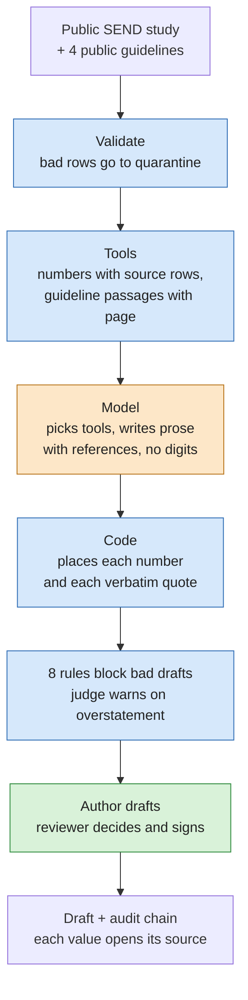
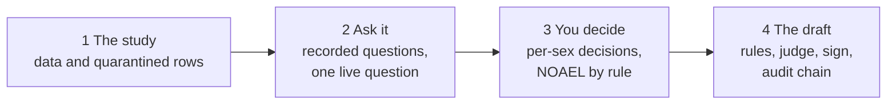
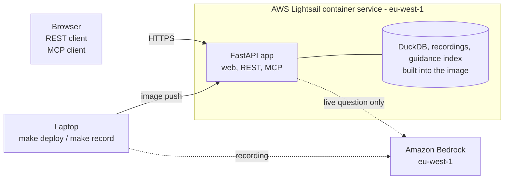

# Cairn

**From a public toxicology study to a draft nonclinical summary - and every number and quotation can be traced.**

Cairn is a working demo of an agentic assistant for drug safety scientists.
It reads a public SEND study (PhUSE PDS2014, fictitious compound) and drafts text in the style of CTD 2.6.6.3.
The model picks tools and writes prose.
Code places every number and every verbatim quotation.
People make the scientific decisions, and the audit trail records them.

> Public sample data - fictitious compound - not GxP-validated.

**Try it:** https://cairn.v2m8ts8nv4tzc.eu-west-1.cs.amazonlightsail.com/study

## How it works

Orange is the model, blue is code, green is people.

## Who does what

```mermaid
flowchart LR
    subgraph M["Model - Claude on Bedrock"]
        m1["Chooses which tools to call"]
        m2["Writes the prose, never a digit"]
        m3["Judge flags overstated wording"]
    end
    subgraph C["Code"]
        c1["Computes every number<br/>from fixed queries"]
        c2["Copies every quotation<br/>with guideline, section, page"]
        c3["Blocks drafts that break a rule"]
        c4["Derives the NOAEL<br/>from people's decisions"]
        c5["Hash-chains every action"]
    end
    subgraph P["People"]
        p1["Decide treatment relatedness<br/>and adversity"]
        p2["Reviewer signs<br/>the author cannot sign their own draft"]
    end
    M --> C --> P
```

## The demo in four steps

The walkthrough replays real Amazon Bedrock recordings kept in `recordings/`, so it runs offline and costs nothing.
One live question to the model is available behind an access code and a daily spend cap (2 USD per UTC day).
The live box only appears when the server has a code configured, and the code is never in this repository.
The interface is in Spanish and English; the draft is in English.

## Where it runs

CI runs the checks on every push; nothing deploys from CI.
The same tools are exposed over REST (`POST /api/tools/{name}`, OpenAPI at `/docs`) and MCP (`/mcp`).
A second workflow, `data-quality-memo`, runs from configuration alone in `workflows/`.

## Run it locally

Needs Docker for the demo; the checks need Python 3.12 with [uv](https://docs.astral.sh/uv/) and Node.js 22.

| To do | Command |
|---|---|
| Serve the demo on http://127.0.0.1:8000 (offline, replays the recordings) | `make demo` |
| Prove the demo works with no network | `make demo-offline-check` |
| Run every check (lint, types, tests, hooks) | `uv sync`, `npm ci`, `make weights`, then `npm run check` |
| Ask one live question (laptop, spends money, prints the ceiling first) | `make live AWS_PROFILE=<profile> QUESTION=Q2` |
| Deploy to Lightsail | `make deploy` (see [docs/production.md](docs/production.md)) |

`make weights` downloads the pinned retrieval models and checks their SHA-256.
Other targets (`record`, `record-draft`, `record-memo`, `record-judge`, `smoke`, `guidance`, `guidance-check`) are listed in the `Makefile`.

## More

- [docs/production.md](docs/production.md): what production would need; nothing there is built.
- [docs/adr/ADR-001-bedrock.md](docs/adr/ADR-001-bedrock.md): why Amazon Bedrock in `eu-west-1`, and which models.
- [docs/security.md](docs/security.md): known security findings and their status.
- [docs/plans/0_plan_maestro.md](docs/plans/0_plan_maestro.md): the master plan and what each phase delivered.
- [docs/como-trabajar.md](docs/como-trabajar.md): how the project was built with SDD Lite (in Spanish).
- [docs/estilo.md](docs/estilo.md): the visual style of the demo.

## Limits

- One study, four public guidelines, descriptive statistics only.
- Not GxP-validated: no validation package, no electronic signatures.
- The audit chain is tamper-evident, not tamper-proof.
- Licensed under Apache-2.0; the study data keep their own licence in `data/pds2014/LICENSE.md`.
